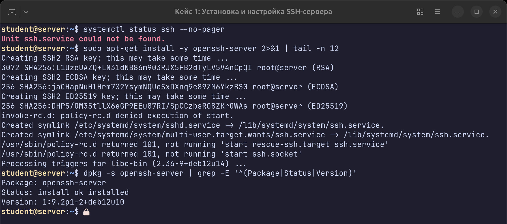
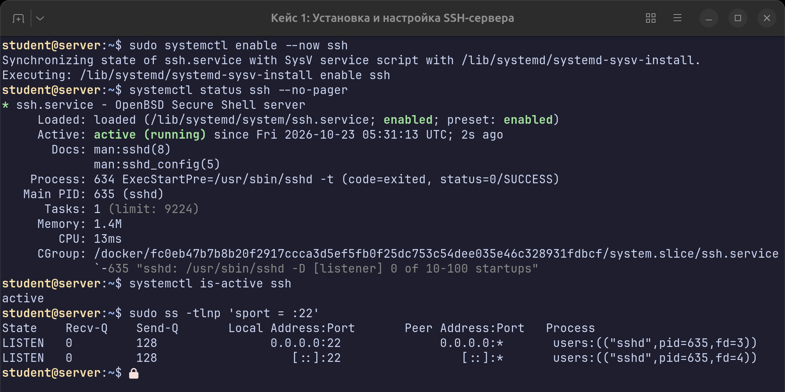
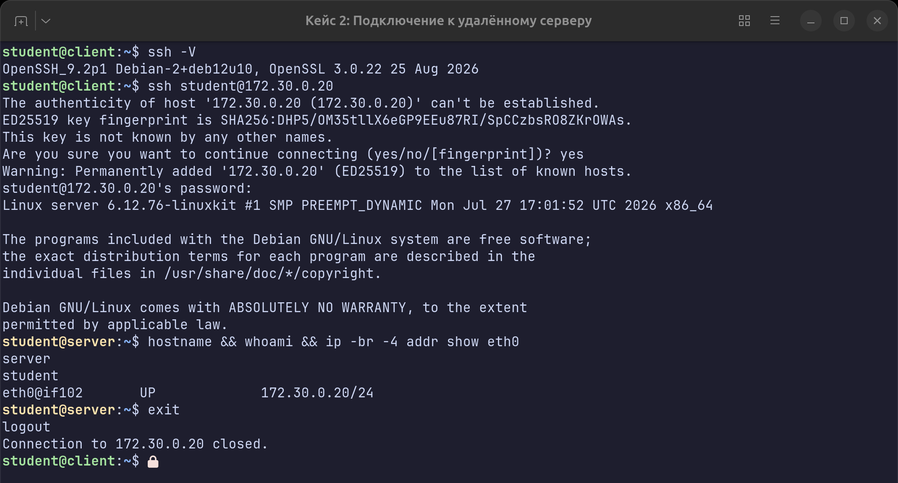
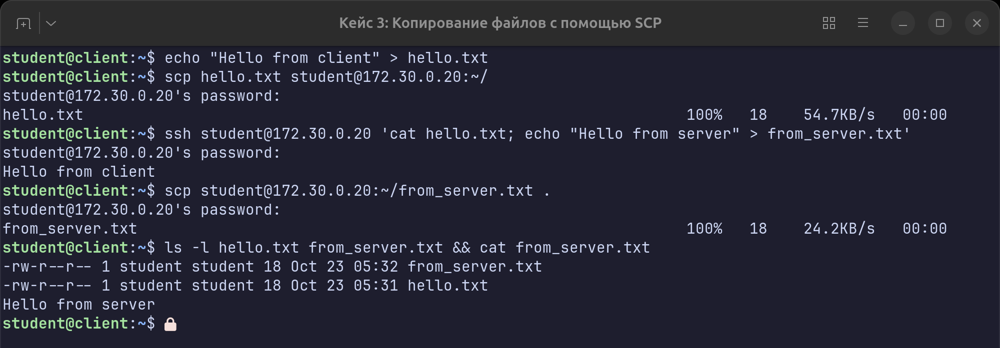
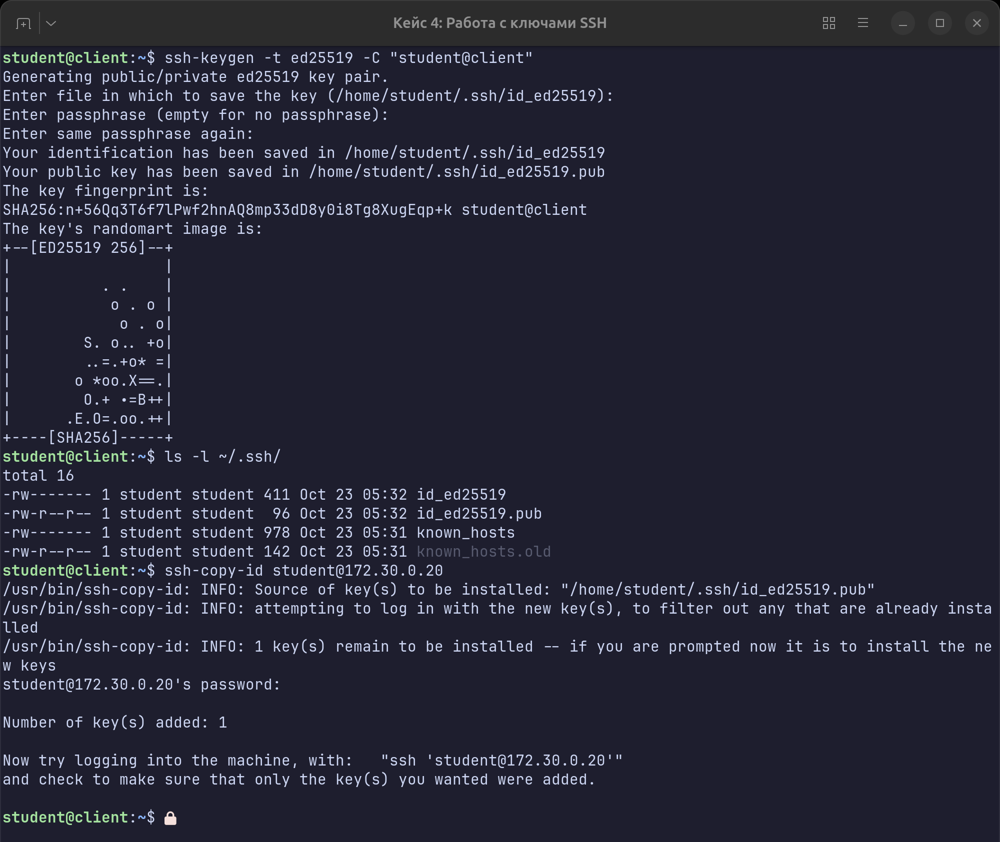
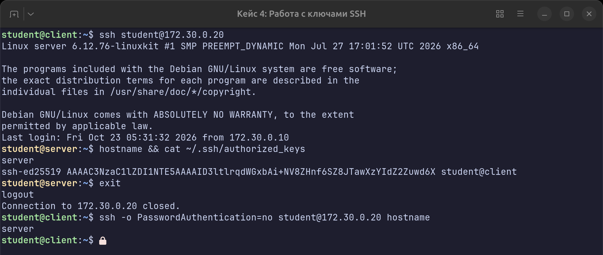

# ДЗ 3. Работа с серверами и SSH

Выполнил Старков Д.С.

Сделаны первые четыре кейса из [04.practice_ssh.pdf](https://github.com/CanUFeelMyHeart/urfy_seminars/blob/main/%D0%9F%D1%80%D0%B0%D0%BA%D1%82%D0%B8%D0%BA%D0%B0/04.practice_ssh.pdf) (репозиторий [urfy_seminars](https://github.com/CanUFeelMyHeart/urfy_seminars)): установка sshd, подключение, scp, ключи.

## На чём делал

Вместо виртуалки поднял два контейнера с Debian 12 в Docker, так не нужно трогать sshd на основной системе. Образ с systemd, чтобы внутри нормально работал `systemctl`:

- `client`: 172.30.0.10, отсюда подключаюсь
- `server`: 172.30.0.20, сюда ставлю SSH-сервер

На обоих есть пользователь `student` с паролем `student`. Всё, что нужно для стенда, лежит в папке `lab/`:

```bash
cd lab
./setup.sh      # собрать образ и запустить client + server
docker exec -it -u student server bash   # зайти на сервер
docker exec -it -u student client bash   # зайти на клиент
./teardown.sh   # удалить всё
```

Промпт на клиенте зелёный, на сервере жёлтый, так на скриншотах проще понять, где выполняется команда.

## Кейс 1. Установка SSH-сервера

Сначала проверил, что сервера на машине нет: `systemctl status ssh` пишет `Unit ssh.service could not be found`. Потом поставил:

```bash
sudo apt-get install -y openssh-server
dpkg -s openssh-server | grep -E '^(Package|Status|Version)'
```

При установке сразу сгенерировались ключи хоста (RSA, ECDSA, ED25519).



Сам сервис после установки не запустился: в конце вывода `policy-rc.d denied execution of start`. В докер-образах Debian автозапуск служб при установке пакетов запрещён, на обычной машине такого не будет. Поэтому включил и запустил руками:

```bash
sudo systemctl enable --now ssh
systemctl status ssh --no-pager
sudo ss -tlnp 'sport = :22'
```

Статус `active (running)`, sshd слушает 22 порт на IPv4 и IPv6.



Конфиг `/etc/ssh/sshd_config` не менял, для этих кейсов хватило стандартного (вход по паролю и по ключам там включён по умолчанию).

## Кейс 2. Подключение к серверу

С клиента:

```bash
ssh student@172.30.0.20
```

При первом подключении ssh спрашивает, доверять ли ключу хоста. Отпечаток `SHA256:DHP5/OM35...` совпадает с ED25519-ключом, который сгенерировался при установке в кейсе 1, так что ответил `yes`. Дальше ввёл пароль и попал на сервер. Проверил, что это действительно server:

```bash
hostname && whoami && ip -br -4 addr show eth0
```



## Кейс 3. Копирование файлов через scp

Сначала создал файл на клиенте и отправил его в домашнюю папку на сервере:

```bash
echo "Hello from client" > hello.txt
scp hello.txt student@172.30.0.20:~/
```

Проверил через ssh, что файл дошёл, и заодно создал на сервере второй файл, чтобы было что скачивать обратно:

```bash
ssh student@172.30.0.20 'cat hello.txt; echo "Hello from server" > from_server.txt'
```

Потом скачал `from_server.txt` с сервера на клиент:

```bash
scp student@172.30.0.20:~/from_server.txt .
ls -l hello.txt from_server.txt && cat from_server.txt
```



Пароль здесь пришлось вводить на каждую команду, ключей ещё не было.

## Кейс 4. Ключи SSH

Сгенерировал пару ключей ed25519 (путь по умолчанию, без пароля на ключ):

```bash
ssh-keygen -t ed25519 -C "student@client"
ls -l ~/.ssh/
```

Приватный ключ `id_ed25519` с правами 600, публичный `id_ed25519.pub` с правами 644.

Публичный ключ закинул на сервер через `ssh-copy-id`, пароль тут спрашивается последний раз:

```bash
ssh-copy-id student@172.30.0.20
```



Можно было сделать и вручную (`cat ~/.ssh/id_ed25519.pub | ssh student@172.30.0.20 'cat >> ~/.ssh/authorized_keys'`), но тогда надо самому следить за правами на `~/.ssh`, а `ssh-copy-id` делает это сам.

Проверка: `ssh student@172.30.0.20` пустил сразу, без пароля. На сервере в `~/.ssh/authorized_keys` лежит мой ключ с комментарием `student@client`.

Чтобы точно убедиться, что вход идёт по ключу, а не по паролю, запретил парольную аутентификацию со стороны клиента:

```bash
ssh -o PasswordAuthentication=no student@172.30.0.20 hostname
```

Вернуло `server`, значит ключ работает.



## Что было не так по ходу

- Сначала ssh на сервер не пускал вообще, хотя пароль правильный. Оказалось, что в контейнере висит файл `/run/nologin` (его убирает служба `systemd-user-sessions`, а в минимальном образе её никто не запускает). Добавил её запуск в `setup.sh`.
- Debian при выходе из ssh-сессии очищает экран (`~/.bash_logout`), и вывод пропадал до того, как я успевал сделать скриншот. Удалил этот файл в Dockerfile.
